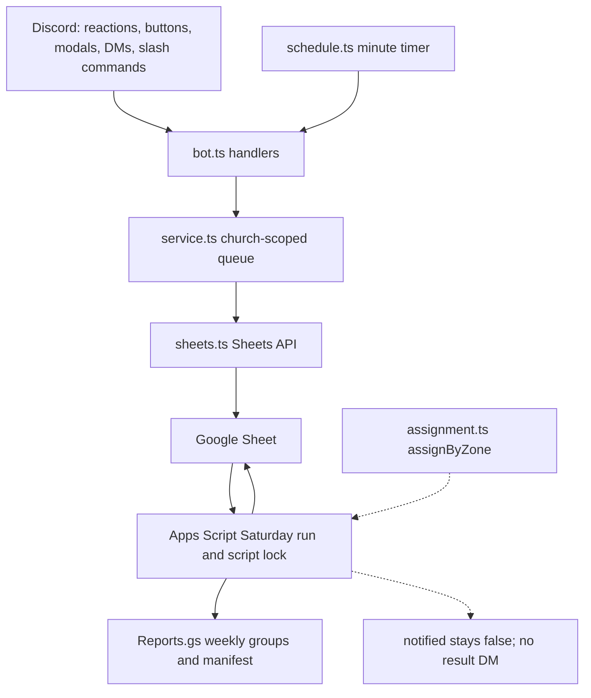

# Chariot

[](https://github.com/Jam3sl1u/Chariot/actions/workflows/ci.yml)

Chariot coordinates weekly church rides in Discord. Members register and request a seat from a post. Drivers mark that they can drive. A Google Sheet is the database, and a Google Apps Script job assigns riders to drivers on Saturday.

It is a TypeScript Node bot (`discord.js`, Google Sheets API) plus an Apps Script workbook. One spreadsheet can hold more than one church. Each data row carries a `churchId`. Churches are expected to share one Discord server and one rides channel. The bot tells them apart by the id of the current weekly post.

There is no web app in this repository, and no working public demo.

## Operational status

"Works today" means the behavior is in this code and covered by the automated tests. Those tests use in-memory doubles. They do not call Discord or Google. The manual acceptance test in [`docs/discord-bot.md`](docs/discord-bot.md) is how to check a live server and Sheet. This repository does not record that test as completed.

| Area | Status | What is true in this repo |
|---|---|---|
| Weekly posts, registration, ride reactions | Works today | Implemented and tested. The first reaction writes a pending profile before the form is finished. That differs from the original PRD sentence. |
| Driver availability | Works today | A reaction on the current driver ask opts the driver in or out. An older YES/NO direct-message parser is still in the source and is not what new asks use. |
| Several churches in one server and one Sheet | Works today as code | Routing, isolation, and tests use more than one church id. The repo does not record which real clubs, if any, are live. |
| Saturday assignment | Partial | The planner is tested in TypeScript and ported to Apps Script. A live two-church Sheet run is not recorded. |
| Assignment result messages | Planned | The Sheet has a `notified` column. The script writes it false. The bot never reads it and never sends the result. |
| Scheduler, catch-up, broadcasts | Works today | Jobs, retries, same-week catch-up, and broadcasts are implemented and tested. |
| "Clear state on startup" and "no scheduler" | Superseded | Startup keeps the week's posts. Scheduled work runs only for churches with an enabled `Schedules` row. |

The full requirement table, with the evidence for each row, is [`docs/requirements-history.md`](docs/requirements-history.md).

## What people actually do

Weekly post text comes from the Sheet (`weeklyMessageTemplate`), not from a fixed string in the bot. Driver asks use `driverAskMessageTemplate`, with `{churchName}` and `{weekDate}` filled in. Church ids below are placeholders.

An admin with Manage Server runs these in the rides channel, except the driver ask, which runs in the driver channel:

```text
/rides post church:CH01
/rides sync church:CH01
/rides ask-drivers church:CH01
/rides broadcast name:sunday
```

`/register` does not open the form. It replies: "Tap the Register button on your church's weekly post, or react to it, to sign up."

A weekly post carries a button labeled **Register for rides**. A driver ask carries **Sign up to drive**. On a broadcast, only the greeting has that button. The church messages under it do not.

The registration modal is titled "Register for church rides" (or "Sign up to drive"). The fields are full name, phone, optional ride preferences, seats offered, and a pickup location. Blank seats means the person needs a ride. A number from 1 to 20 signs them up as a driver as well. The location list is the first 24 zones plus "Other / Not Listed".

Someone who is already registered and taps the rides button gets an ephemeral reply: "You're already registered. React to the weekly post to request a ride." If the Sheet is slow, the button says: "Chariot is busy right now. Please tap the button again in a few seconds."

An unregistered reaction stays on the post. The bot also writes a pending member and a pending ride request, then DMs a button. The default DM text is `[Church name] Complete your registration before requesting a ride.` The church row can replace that sentence with `registrationDmTemplate`. Removing the reaction cancels the request. Adding it again reuses the same row.

A reaction on the current driver ask marks that person available for the week. The follow-up DM asks them to finish sign-up or to set seats. The short modal is titled "How many seats can you offer?"

A scheduled job stores the command as exact text, for example `/rides post church:CH01` or `/rides broadcast name:sunday`. Anything else is rejected.

### Screenshots worth capturing

This README has no screenshots. Useful ones, from a test server, with real names, phone numbers, and Discord ids cropped out:

1. A weekly ride post with the **Register for rides** button.
2. A broadcast: the button on the greeting, and none on the church posts under it.
3. The registration modal, including the location dropdown.
4. The ephemeral "already registered" reply, and the "busy, tap again" reply.
5. A driver ask with **Sign up to drive**, and the seats-only modal.
6. The registration DM with **Start registration** or **Start driver sign-up**.
7. An admin's ephemeral result from `/rides post` or `/rides broadcast`, using test church ids.

## Key features

- Ride requests are any emoji on the current weekly post. Removal cancels the request.
- One registration is reused when the same person requests a ride from another church in the workbook. Each church still gets its own member row, so assignments stay separated.
- Driver opt-in is a reaction. A person who already drives for another church is copied into this church with the same seats and home zone. A new volunteer gets a placeholder driver row (4 seats, `signupStatus` PENDING) until the form is finished. The Saturday job skips PENDING drivers.
- `/rides broadcast` posts one greeting and then one message per listed church. Running it by hand replaces the previous block. A scheduled broadcast does not replace a block that is already up for the week.
- `/rides sync` rebuilds ride requests and driver availability from the reactions still on the current posts, including reactions added while the bot was offline.
- Admins can also put a plain message, a command, or both on the `Schedules` tab. The message is sent first. A later retry does not send it again.
- After assignments exist for the week (`assignmentCompletedWeek`), new ride requests and new driver opt-ins are refused. Cancellations and opt-outs still work.
- Sheet writes use raw input, so a name that starts with `=` is stored as text.

## Architecture



The dotted line from `assignment.ts` means the Saturday job is a separate copy of the same rules (`assignByZone_` in `apps-script/Code.gs`). The bot does not call the TypeScript planner when Saturday arrives. `Reports.gs` can write a groups tab and a ride manifest from the assignment rows. Those sheets contain member fields, so they are an admin view inside the workbook, not a public page.

`Service` is a single in-process queue. Before a write it resolves the church again. A guild, channel, or message that matches zero churches, or more than one, is logged and dropped. Zones are the shared table. Every other data tab is filtered by `churchId`.

## Matching

`assignByZone` is a pure function. It does not read the Sheet. For one `churchId` it keeps pending riders and available drivers from that church only. A driver is skipped when `signupStatus` is PENDING, when they are marked unavailable, or when they have no seats left.

It is a deterministic greedy loop. While riders remain, it scores every rider and driver pair that still has room and keeps the best pair:

1. Same housing (`driver.homeZone === rider.zone`) wins over a different zone.
2. Then shorter distance. Distance is a seeded foot value when one exists, otherwise haversine from zone coordinates, otherwise a large sentinel so unknown pairs sort last.
3. Then the church's zone priority number.
4. Then `requestId`, then `driverId`.

A rider whose zone is missing, unknown, or "Other / Not Listed" is left unassigned with a location reason. Everyone else who cannot fit is left unassigned with a capacity reason. A `hasPlusOne` flag uses two seats. The product does not collect guests, so that flag stays false unless someone sets it in the Sheet.

The Apps Script port adds one behavior the unit tests of the pure function do not: a second Saturday run keeps riders who already have a seat, frees a cancelled rider's seat, and only fills riders who are still pending or still unassigned.

This is not the PRD's "fixed zone priority only" rule. Same housing and distance come first. That mismatch is recorded in [`AGENTS.md`](AGENTS.md) and is still an open product choice.

## Scheduling and reliability

The process runs one pass at startup and then every minute. A pass reads `Churches` and `Schedules` unless a job is due, a server is seen for the first time, or the weekly driver reset is stale.

A job is due from its local day and time through the end of that church's Monday-to-Sunday week. If the bot was down, the job runs once when it returns, as long as the week has not rolled over. `lastRunWeek` stops a second run. Last week's success does not count for this week, and last week's missed job is not replayed.

Failures are stored on the row (`lastStatus`, `lastError`) and retried on later minutes, up to three attempts that week. One bad job does not stop the others. Duplicate `jobId` values are not run. An invalid row is noted once, not every minute.

A plain scheduled message is claimed in `messageSentWeek` as `pending:<week>` before Discord is called. A failed send clears the claim and can be retried. If the process dies after the claim and before Discord confirms, the row is marked failed and the message is not sent again, because it might already be in the channel. An admin clears `messageSentWeek` and `attempts` to try on purpose.

Weekly ride posts and driver asks are skipped when this week's message id is already saved, unless the caller asked to replace them. If the Sheet write after a new post fails, the bot deletes the Discord message it just sent. A hand-run broadcast replaces the old block on purpose. If that delete fails, the reply says the old message could not be removed.

Sheet calls retry HTTP 429, 500, 502, 503, and 504, up to six attempts, with exponential backoff capped at 20 seconds. Other errors are not retried.

These rules assume one bot process. A second process can post as well. The script lock inside Apps Script does not lock the bot's API writes. Discord and the Sheet are not one transaction.

## Testing and CI

`npm test` runs Node's built-in runner on `tests/*.test.ts`. When this README was written the run was 100 tests, 100 passed, 0 failed. `npm run typecheck` was clean. Neither command touches a live Discord server or Sheet.

Representative cases:

- `tests/assignment.test.ts`: "mixed input rows never cross church boundaries", "a driver takes a rider from the same housing unit before a higher-priority distant rider", "a PENDING driver is never assigned riders".
- `tests/service.test.ts`: "churches sharing a guild and channel are isolated by active message", "one registration is reused when the member requests a ride from another church".
- `tests/schedule.test.ts`: "a missed job catches up however late in the same week, once", "a claimed but unconfirmed message is reported FAILED, not resent, skips the command and is not retried", "a failing job retries on later ticks up to 3 times".
- `tests/bot.test.ts`: "Thursday posts one driver ask per church, resets availability, and does not repeat that week".
- `tests/broadcast.test.ts`: "a broadcast cannot run twice at once", "if saving a new post fails, the just-sent message is deleted so no orphan is left".
- `tests/sheets.test.ts`: "Sheets retries rate limits with backoff but not other errors".

[`.github/workflows/ci.yml`](.github/workflows/ci.yml) runs on every branch push and on pull requests. Two jobs, both on Node 22.12.0:

- **CI / typecheck:** `npm ci`, a pull-request title check (`feat:`, `fix:`, `docs:`, `test:`, `ci:`, `chore:`, or `refactor:`), `npm run typecheck`, and `npm run changelog:check`.
- **CI / test:** `npm ci` and `npm test`.

The badge above is the `CI` workflow. A separate release workflow tags merges to `main` and refreshes [`docs/change-history.md`](docs/change-history.md) and [`CHANGELOG.md`](CHANGELOG.md). With no GitHub App configured, that refresh is pushed straight to `main`. With `CHANGELOG_APP_CLIENT_ID` and `CHANGELOG_APP_PRIVATE_KEY` set in GitHub, it opens and squash-merges a pull request instead. Those values are repository secrets and variables, not entries in `.env`.

## Setup

Node.js 22.12 or newer.

```text
npm ci
```

Copy [`.env.example`](.env.example) to `.env`. The bot reads these names and no others:

- `DISCORD_BOT_TOKEN`
- `GOOGLE_SHEET_ID`
- `GOOGLE_SERVICE_ACCOUNT_KEY_PATH` (local default `./service-account-key.json`)

Do not commit `.env` or the key file. Share the Sheet with the service account as an editor. Enable the Sheets API on that Google project. Then, with the bot stopped:

```text
npm run setup:sheets
npm run verify:sheets
npm start
```

`setup:sheets` appends supporting headers and creates the `Broadcasts` and `Schedules` tabs if they are missing. It does not create the six base tabs or invite the bot. Column lists, permissions, the Saturday script install, and the manual test are in [`docs/discord-bot.md`](docs/discord-bot.md).

One-time data scripts, also with the bot stopped: `npm run migrate:zones-global`, `npm run seed:priority-zones`, `npm run seed:routing-data`. `npm run seed:assignment-test` and `npm run verify:assignment-test` load and check two-church test rows. Do not point those at a Sheet the live bot is writing.

## Project structure

| Path | What it is |
|---|---|
| [`src/bot.ts`](src/bot.ts) | Discord client, commands, posts, reactions, scheduler loop. |
| [`src/service.ts`](src/service.ts) | Church resolution and Sheet writes. |
| [`src/assignment.ts`](src/assignment.ts) | Pure assignment function. |
| [`src/schedule.ts`](src/schedule.ts) | Job parsing, due check, retry limit. |
| [`src/sheets.ts`](src/sheets.ts) | Sheets client, headers, retries. |
| [`src/broadcast.ts`](src/broadcast.ts) | Broadcast row validation. |
| [`apps-script/Code.gs`](apps-script/Code.gs) | Saturday assignment, trigger, lock, sheet buttons. |
| [`apps-script/Reports.gs`](apps-script/Reports.gs) | Weekly groups and ride manifest. |
| [`tests/`](tests/) | In-memory tests. |
| [`scripts/`](scripts/) | Sheet setup helpers, seeds, changelog generator. |
| [`documentation/prd/`](documentation/prd/) | Product requirements. Read-only for day-to-day bot work. |
| [`documentation/seed-data/`](documentation/seed-data/) | Pickup points and distance tables used by the routing seed. |

## Decisions and trade-offs

- The MVP stores data in a Sheet instead of Postgres. That keeps the admin view in a workbook and gives up transactions and unique constraints. The bot only patches named cells. Do not sort or delete data rows while it is writing.
- Churches share a server and a channel, so the bot cannot route on guild id alone. It routes on `activeMessageId` and `driverAskMessageId`, and it refuses the write when that lookup is ambiguous.
- The planner lives twice: a tested TypeScript function, and an Apps Script copy, because the Saturday job runs inside the spreadsheet rather than in the bot. The two can drift. The TypeScript tests do not execute `Code.gs`.
- Same housing, then distance, then zone priority is a better fit for a campus pickup list than zone priority alone. It is also a quiet disagreement with the PRD. The code was not simplified to match the PRD, and the PRD was not edited to match the code.
- Scheduled messages prefer a missed send over a second send. An unconfirmed claim is failed and not retried.
- Replacing a broadcast deletes the old posts after the new ones are saved. That is a deliberate second post, followed by a delete, not an accidental double post.
- The release job may push a changelog commit directly to `main` when the GitHub App is not configured. That keeps the history current and bypasses pull-request review for that one commit.

## Limitations

- Nobody is DM'd their Saturday assignment. `notified` stays false.
- A live dry run and a pilot with real churches are not recorded here. Multi-church support in code is not the same thing as more than one club using it.
- Two bot processes can both post. Run one.
- Catch-up stops at the end of the church's week. A job missed until Monday is skipped.
- If a replace cannot delete the old Discord message, both messages can remain until someone removes the old one.
- The registration form can show only 24 zones, plus "Other / Not Listed".
- Guest rides are not collected.
- `Members.canDrive` is written for people reading the Sheet. No assignment rule reads it.
- The YES/NO driver reply code is still reachable only if a driver row already has `askedWeek` and `askMessageId` set. Current asks clear those cells.

## Roadmap

1. Send assignment DMs and set `notified` (MVP-007 / M.6). That is the missing step in ask, assign, notify.
2. Run and record the manual two-church assignment check, then the acceptance test in [`docs/discord-bot.md`](docs/discord-bot.md) (M.5, M.7, M.8).
3. Decide whether the PRD's zone-priority rule or the code's housing-and-distance rule is the one to keep.
4. Guest rides stay deferred until someone decides the product (MVP-003).
5. The web app, SMS, standing requests, and the rest of PRD sections 1 to 28 stay out of this repo until the MVP graduation criteria in the PRD are met.

## More detail

- [Install, columns, scheduler, and the manual test](docs/discord-bot.md)
- [Requirement status and evidence](docs/requirements-history.md)
- [Generated change history](docs/change-history.md) and [`CHANGELOG.md`](CHANGELOG.md)
- [PRD](documentation/prd/Chariot_PRD_v2_3.md), section 29 is the MVP
- [Agent working agreement](AGENTS.md)
